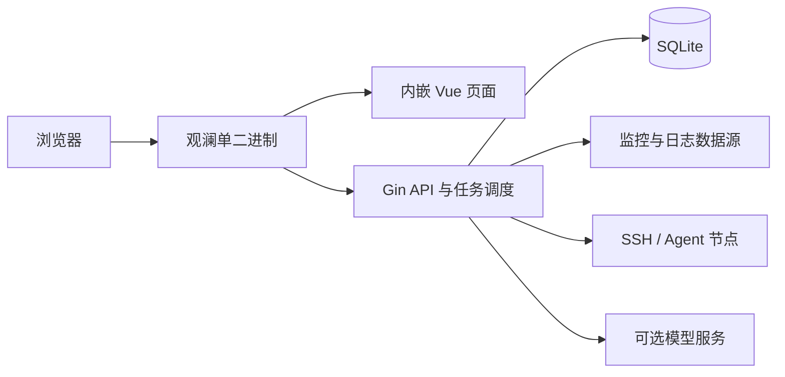

<div align="center">

# 观澜运维平台 · Guanlan

**把监控接入、告警治理、拨测和自动化，放进一个运维工作台。**

Go + Vue 3 · SQLite · 单二进制部署 · AI 辅助排障

[快速开始](#快速开始) · [功能概览](#功能概览) · [配置说明](#配置说明) · [本地开发](#本地开发) · [路线图](#路线图)

</div>

---

观澜是一个面向运维、SRE 和基础设施团队的运维平台。你可以在同一界面管理监控数据源、查看指标、配置告警、执行拨测，并通过脚本、工作流和远程节点完成自动化任务。

前端资源和默认配置直接嵌入 Go 程序，业务数据使用 SQLite。构建后，复制一个 `guanlan` 二进制即可启动 Web 页面和 API，无需额外部署 MySQL、Redis 或前端服务器。

项目正在持续迭代。下面的功能概览描述当前实现，尚未完成的能力单独列在路线图中。

## 为什么做观澜

- **减少工具切换**：把监控接入、查询、告警、通知和执行记录集中到一个工作台。
- **部署简单**：一个服务端二进制、一个 SQLite 数据库；首次启动自动建表并初始化管理员。
- **关注运维现场**：概览展示 Prometheus 接入、Agent 探针、拨测任务和今日告警，配合告警与通知趋势图。
- **让 AI 使用真实工具**：右上角机器人支持多轮对话、平台查询及常用资源创建，工具调用有参数校验、权限检查和执行详情。
- **方便本地开发**：后端使用 Air 热重载，前端使用 Vite，依赖关系通过 Wire 装配。

## 功能概览

| 模块 | 当前能力 |
| --- | --- |
| 运维概览 | 4 项核心指标，告警与通知趋势，活跃告警分布、Prometheus 实例启用状态，今日 / 近 7 天 / 近 30 天切换 |
| 接入中心 | Prometheus / VictoriaMetrics 多实例与分组管理，认证、自定义请求头、标签及连接测试 |
| 即时查询与仪表盘 | PromQL 即时与范围查询、日志查询、SQL 查询、查询历史，Grafana 及云日志仪表盘接入 |
| 日志查询 | Loki、Elasticsearch、ClickHouse 日志查询，时间范围与条数限制、字段映射及详情展示 |
| 告警治理 | 规则与规则组、周期评估、故障中心、告警生命周期、静默、抑制、通知路由及告警动作 |
| 拨测监控 | HTTP、ICMP、TCP、证书到期及 Shell/Python 脚本检测，任务分组、多节点执行、执行记录与趋势 |
| 自动化 | 脚本、工作流、Git 制品任务和执行记录 |
| 节点管理 | SSH、Agent 和 Docker 节点，远程连接与任务执行 |
| 通知管理 | 通知渠道、模板、Webhook 发送、成功与失败记录 |
| AI 助手与 MCP | 页面模型管理、聊天与历史会话、指标查询、平台操作工具目录、权限校验及运行追踪 |
| 系统管理 | 用户、角色、菜单、权限、审计日志、本地登录、LDAP / OIDC、API Token |

### AI 助手与 MCP

点击页面右上角的机器人打开聊天侧栏，支持多轮对话、历史会话搜索、模型切换和执行追踪。在「系统设置 → AI 模型」配置 NewAPI、OpenAI 兼容或 Anthropic 连接，模型需支持原生工具调用。配置保存后立即生效，API Key 加密存入数据库，不通过 YAML 或 `APP_AI_*` 配置。

助手使用 **Eino ReAct Agent**，与外部 MCP 客户端共用平台工具和业务权限。除指标、告警、拨测等查询外，也支持创建和修改告警规则，并通过“查找操作 → 查看参数 → 执行”调用数据源、通知、自动化、工作流及系统设置等已登记操作。写操作需要用户明确授权具体动作和目标，执行时重新校验权限并记录审计。

工具覆盖范围以 [平台操作工具目录](docs/architecture/platform-operation-tools.md) 为准。密码重置、API Token 创建及 Agent 令牌交付等操作保留在页面，不通过聊天返回凭据。当前权限以模块级 RBAC 为主，不代表资源级隔离。

默认最多 8 次模型调用、120 秒编排预算、4 个并发请求，同一会话一次执行一个请求。执行追踪在请求结束后展示；部分业务处理尚未支持完整取消，写操作超时后应查询实际状态，避免直接重试。

实现与模型配置详见 [AI 助手架构](docs/architecture/ai-assistant-integration.md)。

## 快速开始

### 1. 从源码构建

构建环境需要 Go 1.25 或更高版本（以 [go.mod](go.mod) 为准）、与 Vite 5 兼容的 Node.js、npm 和 Make。

在仓库根目录执行：

```bash
make build
```

这会安装前端依赖、构建页面，并生成包含页面资源的 `guanlan`：

```text
构建前端 → 嵌入 web/dist → 编译 Go 主程序 → guanlan
```

`make web` 固定使用 1024 MiB 的 Node.js 堆上限。如果前端构建出现堆内存不足，可分步构建并提高上限：

```bash
cd web
npm ci
NODE_OPTIONS=--max-old-space-size=4096 npm run build
cd ..
CGO_ENABLED=0 go build -trimpath -o guanlan .
```

### 2. 启动

```bash
./guanlan
```

打开 **http://127.0.0.1:8080**，页面和 API 共用这个端口。

| 项目 | 默认值 |
| --- | --- |
| 管理员用户名 | `admin` |
| 初始密码 | `admin123` |
| 监听地址 | `:8080` |
| 数据库文件 | `data/aiops.db` |

首次启动自动创建数据库、表结构和初始数据，不需要单独运行 `dbinit`。重复启动不会重置管理员密码或已有业务数据。首次登录后请修改默认密码；对外部署前设置独立的 `auth.jwt_secret`。

`data/aiops.db` 沿用已有安装的数据路径，项目改名不会自动切换数据库。相对路径均基于**进程工作目录**，因此应从固定目录启动服务。

### 3. 部署到其他机器

将与目标操作系统、CPU 架构匹配的 `guanlan` 复制到目标机器，赋予执行权限后运行：

```bash
chmod +x guanlan
./guanlan --conf /etc/guanlan/config.yaml
```

外部配置是可选的；显式指定 `--conf` 时，该文件必须存在且格式正确。运行机器无需安装 Go、Node.js 或 SQLite 命令行工具，数据目录需要可写。

服务端可以独立运行。需要远程执行时，再按 [Agent 接入说明](docs/agent-connection.md) 部署可选的远程 Agent；它不是启动平台的必需组件。

## 配置说明

默认配置位于 [internal/conf/conf/config.yaml](internal/conf/conf/config.yaml)，通过 `go:embed` 内置到程序。外部配置只需填写需要覆盖的字段。

配置优先级，从高到低：

```text
进程环境变量 > 工作目录的 .env > 外部 YAML > 内嵌默认配置
```

- 指定 `--conf`：加载指定 YAML。
- 未指定 `--conf`：尝试加载工作目录的 `conf/config.yaml`，不存在时使用内置配置。
- `.env` 始终从工作目录读取，不跟随 `--conf` 的目录变化。

下面是一份外部配置示例：

```yaml
server:
  addr: ":8080"

auth:
  jwt_secret: "replace-with-your-own-random-secret"

database:
  dsn: "data/aiops.db"

log:
  level: "info"
  format: "json"
  file: ""      # 留空输出控制台；设置路径后同时写入文件
```

| 配置项 | 环境变量 |
| --- | --- |
| `server.addr` | `APP_SERVER_ADDR` |
| `auth.jwt_secret` | `APP_AUTH_JWT_SECRET` |
| `database.dsn` | `APP_DATABASE_DSN` |
| `log.level` | `APP_LOG_LEVEL` |
| `log.format` | `APP_LOG_FORMAT` |
| `log.file` | `APP_LOG_FILE` |

例如，临时调整监听端口：

```bash
APP_SERVER_ADDR=:8081 ./guanlan
```

日志使用 `pkg/logger` 统一封装，支持 `debug / info / warn / error` 级别以及 `text / json` 格式。文件日志为追加写入，当前未内置日志轮转。

邮件通知共用配置文件中的 `smtp` 发信服务，通知对象页面只填写收件人邮箱（支持多个）。在 `conf/config.yaml` 或 `--conf` 指定的文件中配置：

```yaml
smtp:
  host: "smtp.example.com"
  port: 465
  security: "tls" # STARTTLS 使用 starttls，通常端口为 587
  username: "alerts@example.com"
  password: "" # 可用 APP_SMTP_PASSWORD 环境变量设置 SMTP 密码或授权码
  from: "alerts@example.com"
```

以上字段均支持对应的 `APP_SMTP_HOST`、`APP_SMTP_PORT`、`APP_SMTP_SECURITY`、`APP_SMTP_USERNAME`、`APP_SMTP_PASSWORD`、`APP_SMTP_FROM` 环境变量覆盖。配置在后端启动时加载；未配置 SMTP 时仍可保存收件人，发送时会提示配置邮件服务。

后端只维护当前配置与数据库结构：环境变量统一使用 `APP_*`，LDAP YAML 使用 `connection`、`user_search`、`attributes` 分层格式；不提供旧版自动升级或旧字段回退。开发库结构变化时直接调整本地数据库或重建，重启不会自动修正历史业务数据。

更多字段见 [配置示例](configs/config.example.yaml)。不要把真实 API Key、数据库文件或运行环境的 `.env` 提交到仓库。

## 本地开发

### 后端：Air 热重载

```bash
make dev
```

需要指定配置时：

```bash
make dev CONF=./configs/config.example.yaml
```

`make dev` 使用 `0.0.0.0:8081` 启动后端，该地址由 `.air.toml` 的 `full_bin` 设置，会覆盖 YAML 中的监听地址。首次启动会自动构建缺失的前端资源。Air 使用固定版本，不要求全局安装；监听后端源码、生成的 Wire 文件和配置目录。仓库外的配置文件修改后需要手动重启。

项目要求 Go 1.25.0 或更高版本；较旧的 Go 会自动下载所需工具链。Makefile 和 Air 构建默认使用 `https://goproxy.cn,direct`，避免默认代理连接超时；可通过 `GOPROXY` 环境变量覆盖。直接运行 Go 命令时可使用 `GOPROXY=https://goproxy.cn,direct go build .`。

### 前端：Vite 热更新

在另一个终端运行：

```bash
cd web
npm ci
npm run dev
```

访问 **http://127.0.0.1:8080**，Vite 将 `/api`（包括 WebSocket）代理到 `http://127.0.0.1:8081`。端口被占用时 Vite 会直接退出，不会自动换端口。

源码开发与单二进制运行都使用浏览器端口 8080；开始开发前先停止占用该端口的独立服务。

前端修改通过 Vite 即时查看；发布时重新执行 `make build`，将新页面嵌入二进制。Air 不监听前端源码和 `web/dist`。

### Wire 与测试

```bash
# 修改依赖声明或构造函数后重新生成初始化代码
make wire

# 运行 Go 测试
make test
```

`wire.go` 和 `wire_gen.go` 位于 `internal/app`，生成文件应随源码提交，不要手工修改。普通构建及日常 Air 热重载不需要重新运行 Wire。

全新检出仓库时，测试前先执行 `make web`，因为 Go 的静态资源嵌入需要 `web/dist` 存在。

## 项目结构

```text
guanlan/
├── main.go                 服务端入口及前端静态资源嵌入
├── cmd/
│   ├── aiops-agent/        可选远程 Agent
│   └── generate-operation-catalog/  平台操作工具目录生成器
├── internal/
│   ├── app/                应用初始化、Wire 装配与启动
│   ├── ai/                 AI 协议、工具注册和执行编排
│   ├── conf/               配置加载及内嵌默认配置
│   ├── database/           业务表、种子数据和初始化
│   ├── handlers/           API 与业务处理
│   ├── middleware/         业务认证、权限和审计
│   ├── models/             数据模型
│   └── routes/             HTTP 路由
├── pkg/                    公共日志、SQLite 和 HTTP 中间件
├── web/                    Vue 前端，构建产物位于 dist
├── configs/                外部配置示例
├── docs/                   架构、开发与接入文档
├── test/                   冒烟验证与测试资源
├── Dockerfile.agent        Agent 容器构建定义
├── .air.toml               后端热重载配置
└── Makefile                构建、开发和测试命令
```



目录职责详见 [项目目录说明](docs/project-layout.md)。

## 使用边界

- **单实例部署**：当前业务数据存储使用 SQLite，不应把多个服务实例指向同一数据库文件运行。备份时建议先停止服务，再备份数据目录。
- **开发数据库**：首次启动自动建表并初始化数据，不提供历史数据库迁移脚本；结构调整和重建方式见 [数据库说明](docs/database.md)。
- **指标口径**：今日统计使用北京时间；告警按进入 `firing` 的事件计数，通知按发送记录计数，包含测试通知及产生独立记录的重试。缺少历史事件时不会从当前状态反推历史。
- **模型是可选能力**：不配置模型仍可使用平台业务功能；AI 回答依赖所配置模型及工具返回结果，写操作需明确授权并受业务权限约束。模型密钥依赖 `auth.jwt_secret` 加密，更换该配置后需重新保存模型 API Key。

## 路线图

- [x] 单二进制部署、内嵌配置、SQLite 自动初始化。
- [x] 运维概览、告警与通知趋势。
- [x] 右侧 AI 聊天面板、历史会话与执行追踪。
- [x] 系统设置中的模型配置与 API Key 管理。
- [x] 助手与 MCP 共用平台操作目录、权限校验和操作审计。
- [ ] AI 上下文增强、流式响应与完整取消链路。
- [ ] 资源级授权、多步骤排障与知识检索。
- [ ] 写操作审批、批量执行与反馈评估。

AI 阶段规划见 [实施方案](docs/architecture/guanlan-ai-roadmap.md)，已交付能力与当前边界以 [AI 助手架构](docs/architecture/ai-assistant-integration.md) 和 [平台操作工具目录](docs/architecture/platform-operation-tools.md) 为准。

## 文档导航

- [日志查询接入](docs/log-query.md)：Loki、Elasticsearch、ClickHouse 的连接和字段映射。
- [Agent 接入](docs/agent-connection.md)：远程节点部署与连接。
- [告警生命周期](docs/alert-lifecycle-management.md)：告警状态、通知及恢复处理。
- [自动化任务执行](docs/architecture/automation-task-execution.md) 与 [工作流执行](docs/architecture/workflow-dag-execution.md)。
- [数据库说明](docs/database.md) 与 [项目目录](docs/project-layout.md)。

## 参与贡献

欢迎通过 Issue 提交问题、使用反馈和功能建议，也欢迎通过 Pull Request 参与开发。

提交问题时，请提供复现步骤、运行环境和脱敏后的错误信息。提交代码时，请说明改动目的与验证方式；涉及前端资源时执行构建验证，涉及后端逻辑时运行相关 Go 测试。

## 许可证

当前仓库尚未包含 `LICENSE` 文件，许可证待项目维护者确定并补充。
