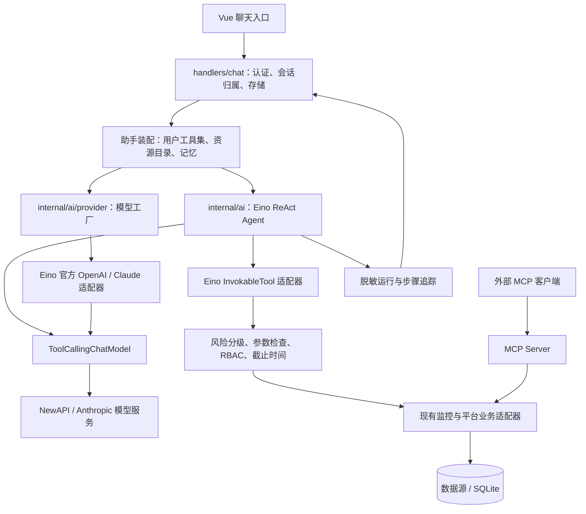

# AI 助手标准架构：Eino ReAct

更新：2026-10-23。Eino 是当前智能体执行底座，已替换手写循环和自定义 `tool_call/final` 模型指令协议。前端聊天 API、会话存储、执行追踪格式保持兼容，追踪 metadata 增加 `engine: eino`。

## 分层与依赖方向

| 层 | 代码 | 职责 |
| --- | --- | --- |
| 会话边界 | `internal/handlers/chat.go` | 身份、会话归属、历史与记忆、并发限制、回答及追踪持久化 |
| 助手装配 | `internal/handlers/ai_assistant.go` | 装配模型、用户可用工具、数据源范围和运行输入 |
| 智能体核心 | `internal/ai/agent.go`、`orchestrator.go` | 创建每次运行独立的 Eino ReAct 图，输入上下文、执行预算和结果映射 |
| 模型基础设施 | `internal/ai/provider` | 配置校验、地址规范化、构造官方模型组件；不依赖 Gin、数据库或全局配置 |
| 工具契约与注册 | `internal/ai/registry.go`、`protocol.go` | 注册业务工具与风险、参数、超时元数据 |
| Eino 工具适配 | `internal/ai/eino_tool.go` | 生成标准 ToolInfo / JSON Schema，接收原生工具参数，回填结果 |
| 执行策略 | `internal/ai/execution.go` | 参数与风险校验、授权回调、子上下文超时、结果大小限制 |
| 业务适配 | `internal/handlers/ai_mcp.go`、现有指标/MCP 处理函数 | 复用平台业务，限制结果字段与资源范围 |

核心包依赖 Eino 标准接口，不导入 handlers、Gin 或数据库。业务适配器通过 Registry 和授权回调注入。当前业务函数仍位于 handlers；以后抽取独立业务 service 时保持工具契约不变，无需修改 Agent。

## 执行协议

使用 Eino `flow/agent/react.NewAgent`，由框架负责消息累计、模型/工具节点切换、原生 tool call ID 关联和循环终止。

- NewAPI / OpenAI：官方 `eino-ext/components/model/openai`，`tools` → `tool_calls` → `role=tool`。
- Anthropic：官方 `eino-ext/components/model/claude`，`tools` → `tool_use` → `tool_result`。
- 最终回答为模型文本，可直接显示 Markdown，不再要求自定义 JSON 包装。
- 默认最多 8 次模型调用，每次最多 8 个工具调用，工具串行执行；总体预算 120 秒。模型调用的限制独立于 Eino 图节点步数。
- 单工具按声明设置 10/15/120 秒截止时间；平台 MCP 查询使用 `WithContext`。
- 每个运行独立图实例、模型包装器和 trace，不跨会话共享可变执行状态。
- 工具失败以结构化结果回填模型，未知工具不执行；失败、取消和超时保留已完成的步骤。
- 本期使用 Generate。尚未提供流式 HTTP、用户停止 API、跨重启恢复或工具写操作审批。

锁定版本：Eino `v0.9.21`、OpenAI adapter `v0.1.13`、Claude adapter `v0.1.26`。升级必须同时验证适配器与核心版本兼容。

## 扩展规范

1. 新模型供应商：在 provider 工厂增加官方 Eino `ToolCallingChatModel` 适配器及协议测试。NewAPI 中切换已支持的模型通常仅修改配置。
2. 新本地工具：注册业务工具，声明参数、风险、超时，绑定对应权限；由 Eino 工具适配器生成 ToolInfo，不能绕过统一策略直接执行业务。
3. 参数声明：直接使用 Eino `schema.ParameterInfo`，经 `ParamsOneOf` 生成标准 JSON Schema。服务端用同一契约校验整数、数字、字符串、枚举、必填、布尔、对象和数组；拒绝未知字段、null、过深嵌套及超大数组。新增参数不能绕过后端校验。平台 MCP 工具的对象、数组和布尔参数映射为相同的 Eino 契约，调用端还校验最小/最大值、文本长度和数组长度。
4. 新业务 service：以普通 Go service 实现查询，把身份/范围经后端校验后传入。查询和连接测试只接收已有资源 ID，不接收任意认证头或命令。创建数据源是显式例外：可接收用户提供的无凭据 HTTP/HTTPS 地址，复用页面校验后仅保存，不在创建时访问地址。
5. 外部 MCP：当前实现是平台 MCP Server 与内置助手复用本地业务。未来接入远程 MCP Client 时，注册得到的工具仍需映射权限、风险等级和超时，不自动信任远端声明。
6. 检索、记忆、计划型工作流：分别扩展运行输入/上下文装配或新增 Eino Graph，不改模型传输层。检索内容不能覆盖后端执行策略。

低风险快捷工具使用 `write_low`；平台目录执行器使用 `write_authorized`，仅执行用户明确要求的具体操作，并在调用时按目录中的权限重新授权。`write_requires_confirmation` 仍不执行。新增 `create_alert_rule` / `update_alert_rule` 和“查找 → 参数说明 → 执行”三项目录工具。目录覆盖 190 项现有业务接口，避免一次性向模型注册数百个工具。实现与边界见 [平台操作工具目录](platform-operation-tools.md)。

## 页面管理模型

在「系统设置 → AI 模型」添加任意多条连接，填写显示名称、Provider（newapi/openai/anthropic）、服务地址、模型标识、API Key 和启用状态。模型及渠道必须支持原生工具调用。保存后立即生效，无需重启。

聊天框列出启用模型；发送时传 `model_id`，后端加载配置并解密凭据。会话记住模型 ID，每条回答 metadata 保存当时的模型 ID 和显示名称。同一会话可以切换模型，历史消息保留。已删除/停用的模型明确拒绝，用户需要重新选择；旧会话尚未绑定模型时可使用首个启用模型。

`config.yaml`、`APP_AI_*`、`ANTHROPIC_*` 不再配置运行模型。已有部署须在页面重新添加配置，不自动导入环境中的凭据。

管理列表需要 `system-setting:list`，保存/删除需要 `system-setting:edit`。登录用户的聊天模型列表只返回 ID、显示名称、Provider 和模型标识，不包含地址和密钥。管理接口也不会回传密钥或密文；编辑时密钥留空保留原值，更换地址或 Provider 必须重新提供密钥。模型密钥使用项目现有 AES-GCM 加密机制，依赖稳定的 `auth.jwt_secret`；更换该密钥后应重新保存模型 API Key。

新增 `ai_models` 表和会话 `model_id` 字段，通过 `2026102001 → 2026102201` 事务迁移升级已有 SQLite 数据库并添加菜单；已有会话不删除。API：`/api/ai-models`、`/api/ai-models/:id`、`/api/chat/models`。

## 工具与权限

| 工具 | 权限 | 范围 |
| --- | --- | --- |
| query_prometheus_instant | datasource:list | 会话绑定的数据源分组 |
| query_alerts | alert:event:list | 平台级告警 |
| query_alert_rules | alert:rule:list | 平台级规则 |
| query_probe_tasks | inspection:list | 平台级拨测任务 |
| query_automation_tasks | automation-task:list | 平台级自动化任务目录 |

工具发现按权限过滤，执行前再次检查用户/角色/权限启用状态。平台级查询不按数据源分组过滤；现有 RBAC 是模块权限，不等同于资源/租户级授权。原有查询快捷工具继续提供摘要；操作目录复用页面业务响应并递归脱敏凭据、配置和执行输出。自动化任务运行可通过目录中的 `run_automation_task` 操作完成，调用时要求 `automation-task:run`。目录工具的 `operation:scoped` 是动态鉴权标记，不是可授予的角色权限。

## 验证与限制

- `go test ./...`：核心策略、Eino 多轮循环、无工具聊天、原生多工具消息、未知工具、失败追踪、轮次限制、取消和权限撤销。
- provider 模拟 HTTP 测试：两类协议原生工具调用、tool call ID 回填、根地址及 `/v1` 路径、认证头。
- `test/smoke/ai_execution.py`：真实二进制登录、NewAPI 模拟服务、Eino 工具调用、追踪落库及历史读取、模型错误脱敏。可通过 `GUANLAN_BINARY` 指定待测二进制。

测试不替代真实模型验收，仍需实际网关地址、密钥与支持工具调用的模型。前端仍请求结束后显示追踪。

参考：[Eino ReAct 源码](https://github.com/cloudwego/eino/tree/v0.9.21/flow/agent/react)、[Eino 官方扩展](https://github.com/cloudwego/eino-ext)、[NewAPI 协议](https://doc.newapi.pro/api/openai-chat/)。

页面模型管理交付验证：全量 Go 测试通过，覆盖模型配置权限、密钥加密/保留/脱敏、停用模型拒绝及数据库升级。前端生产构建通过；浏览器自动化因运行环境缺少 Chromium 系统依赖 `libatk-1.0.so.0` 未完成。API 冒烟覆盖创建两个模型、按 ID 调用、会话切换与记忆、停用后拒绝。
