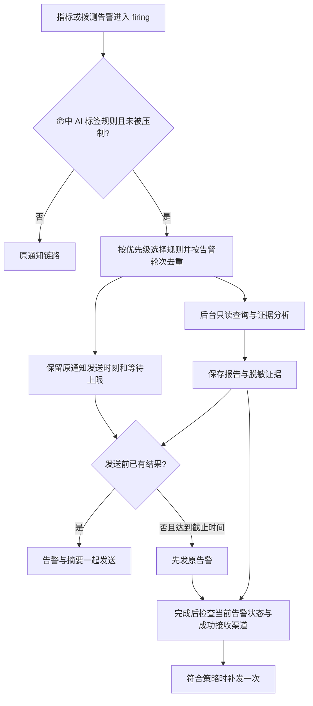

# 故障中心 AI 分析设计：按标签触发、证据查询与通知联动

> 状态：设计稿，尚未实施。日期：2026-10-30。
>
> 本文以当前工作区代码为依据。目标是让命中标签规则的告警自动触发只读分析，并将分析摘要随告警发送；不是对全部告警默认调用 AI，也不是让 AI 自动执行处置任务。

## 1. 业务目标与边界

用户在故障中心配置“AI 分析规则”：匹配哪些标签、使用哪个模型、允许查询哪些数据源。告警满足条件后，AI 查询关联数据并给出可能原因、证据和处理建议。

产品行为：

1. 未配置规则或未命中规则的告警，完全沿用现有通知行为。
2. 命中规则后，在后台创建分析任务，不阻塞指标评估、拨测调度或告警状态流转。
3. 分析及时完成时，原告警和分析摘要合并发送；超时先发原告警，后续按策略补发分析结果。
4. 分析结果关联到具体告警轮次，详情可查看结果和查询依据，重复告警通知复用结果。
5. AI 分析只读。脚本、节点和执行超时仍由自动化任务管理，自动化处置继续由现有规则独立触发。

第一期不自动执行脚本、不修改告警规则、不创建静默、不连接任意主机，不把分析结论作为自动化处置的触发条件。日志、链路、拓扑诊断作为后续扩展，不能把已有页面查询能力等同于已经有可直接复用的 AI 诊断工具。



## 2. 当前业务基础与需要补齐的部分

| 当前能力 | 实现位置 | 本方案如何使用 |
| --- | --- | --- |
| 故障中心及告警实例、事件 | [alert.go 模型](../../internal/models/alert.go)、[告警处理](../../internal/handlers/alert.go) | 按故障中心隔离配置；使用告警事件识别生命周期，不从通知发送次数推导分析次数 |
| 指标告警 | [alert_rule.go](../../internal/handlers/alert_rule.go) | 使用表达式、阈值、数据源、标签、当前值和触发时间作为分析输入 |
| 拨测任务 | [inspection.go](../../internal/handlers/inspection.go) | 使用拨测类型、目标、节点状态及历史结果；脚本拨测只读取自动化任务的既有执行结果 |
| 标签匹配 | `alertLabelNamespaces`、`normalizeAlertLabelMatchers`、`alertMatchesLabelMatchers` | 复用四种标签来源和相等匹配，不新建另一套匹配语义 |
| 静默、抑制、分组通知 | [alert_notification_group.go](../../internal/handlers/alert_notification_group.go) | 分析资格和通知发送都检查静默/抑制；利用现有聚合等待时间 |
| 自动化处置 | [alert_action.go](../../internal/handlers/alert_action.go) | 借鉴数据库任务、租约和调度方式，分析与处置使用独立队列 |
| AI 模型与工具调用 | [ai_assistant.go](../../internal/handlers/ai_assistant.go)、[internal/ai](../../internal/ai/agent.go) | 复用模型工厂、Eino ReAct、参数校验、超时和运行追踪 |
| 平台查询工具 | [ai_mcp.go](../../internal/handlers/ai_mcp.go)、[mcp_platform_catalog.go](../../internal/handlers/mcp_platform_catalog.go) | 复用底层只读查询；增加诊断专用的过滤和脱敏结果投影 |
| 通知模板及渠道包装 | [notification.go](../../internal/handlers/notification.go)、[notification_delivery.go](../../internal/handlers/notification_delivery.go) | 模板渲染后附加 AI 摘要，再生成系统标题、页脚和渠道消息 |
| 调度循环 | [scheduler.go](../../internal/handlers/scheduler.go) | 增加轻量扫描入口，实际模型调用放入有界后台工作池 |

当前还没有告警 AI 规则、分析任务表、分析结果表和通知等待协调机制。现有聊天并发控制是进程内 map，不能直接当成可恢复的后台任务队列。

有三个必须注意的现状：

- `recordAlertEvent` 已调用 `enqueueAlertActions`，但部分调用传入的是 `database.DB`，且忽略返回错误。不能声称现有告警写入、事件和任务创建已经处处原子化。
- 聊天工具注册包含可写工具及通用操作目录，后台分析不能直接调用 `registerAssistantMCPTools` 获取完整工具集。
- 现有 `StepTrace` 有意不保存原始参数与结果；现有告警、拨测、执行记录投影也省略一些诊断字段。分析证据需要单独设计脱敏投影，不能直接扩大所有聊天工具的返回字段。

## 3. 页面设计

在“首页 / 故障中心 / 当前名称”的现有详情页中新增 **AI 分析** 页签，与告警静默、告警抑制、分组收敛、自动化处置并列。

### 3.1 AI 分析规则列表

顶部工具栏：按名称搜索、启用状态、刷新、创建。工具栏放在表格卡片外。

列表列：规则名称、匹配标签、模型、优先级、通知方式、启用状态、最近分析时间、编辑/删除。

创建抽屉直接填写规则，不再加来源卡片，因为本功能没有不同来源的创建路径。抽屉标题区与页面 header 同高，底部保留取消/保存。

| 配置项 | 建议默认值 | 说明 |
| --- | --- | --- |
| 规则名称 | 必填 | 同一故障中心内唯一 |
| 匹配标签 | 至少一项 | 沿用现有标签来源、Key、Value 控件 |
| 使用模型 | 必选 | 只列出启用且可用的模型，不返回密钥 |
| 优先级 | 100 | 数值越小优先级越高；用于多条规则同时命中时选定唯一模型与策略 |
| 查询数据源 | 当前告警来源 | 可显式添加允许查询的其他数据源；不默认扫描全平台 |
| 通知方式 | 等待结果，超时先通知 | 可切换“立即通知，分析后补发” |
| 最长额外等待 | 25 秒 | 可设 0–30 秒；这不是 AI 的运行超时 |
| 分析完成后补发 | 开启 | 仅当原告警已成功发送但没有携带本次分析结果时生效 |
| 启用 | 开启 | 全局无规则时仍不会自动分析任何告警 |

规则不再配置独立通知对象：沿用故障中心现有通知路由，避免一条告警因 AI 规则被发送到另一组人员。

分析超时、查询窗口、调用预算等放在折叠的“高级设置”，第一期采用服务端默认值即可，不把所有参数都暴露给普通使用者。

### 3.2 告警详情中的结果

告警详情增加“AI 分析”区块，展示：

- 未匹配规则 / 等待分析 / 分析中 / 已完成 / 证据不足 / 超时 / 失败 / 已跳过。
- 简短结论、可能原因、证据、建议操作、缺失信息。
- 使用模型、开始/结束时间、分析覆盖的告警轮次。
- “查询依据”默认折叠，展示脱敏的查询表达式、时间范围、数据源名称和证据摘要。

不恢复此前移除的页面“返回 + 名称 + 编辑图标”标题行。查看分析记录与现有详情、面包屑样式一致。

## 4. 标签规则与多规则命中

沿用 `AlertLabelMatcher{namespace,key,value}`，第一期只支持相等匹配。

| namespace | 页面名称 | 示例 |
| --- | --- | --- |
| `system_labels` | 系统标签 | `severity=P0`、`alertname=支付接口错误率`、`datasource=生产监控` |
| `labels` | 告警标签 | 指标的 `service=payment`、`instance=10.0.0.8:9100`，或拨测生成的 `task_name`、`target` 等标签 |
| `datasource_labels` | 数据源标签 | `env=prod`、`region=cn-shanghai`，以实际快照为准 |
| `external_labels` | 额外标签 | 告警规则/拨测任务配置的 `team=payment`、`env=prod` |

当前 UI 某些地方把 `labels` 称为“PromQL 标签”。AI 分析规则同时覆盖拨测时，建议显示“告警标签”，注明包括指标标签和拨测标签。缺失标签视为不匹配，不能猜测或补全其值。

- 同一规则内全部条件为 AND；不同规则是候选 OR。
- 同一 namespace 的同一 Key 不允许在一条规则中重复。要匹配 P0 或 P1，应建两条规则，不能写成同一条规则的两个 `severity` 条件。
- 至少一项条件，最多 10 项。第一期不提供“匹配全部”或空条件规则。
- 命中多条时按 `priority ASC, id ASC` 选一条作为执行规则，其余命中规则 ID 只记录到审计快照。
- **一轮告警即使命中多条规则也只分析一次**，不会分别请求多个模型。规则之间不是按先后连续执行。

例：`system_labels.severity=P0 AND external_labels.env=prod AND labels.service=payment`。如果该告警实际把 `env` 放在数据源标签中，就必须选择 `datasource_labels.env`；各命名空间不隐式互相替代。

## 5. 触发时机、轮次与去重

### 5.1 明确“同一轮告警”

不能仅用 fingerprint 或 `(alert_id, rule_id)` 去重：fingerprint 可能跨多轮复用，模型或规则变化也不应让同一轮再分析。

建议为 `AlertInstance` 新增 `analysis_episode`（递增整数）：

- 首次进入 `firing`，设为 1。
- `pending → firing` 开启一轮。
- `recovering → firing` 属于恢复观察期内抖动，仍是同一轮，不递增。
- `resolved/terminated → firing` 如果复用同一实例，则递增；如果现有业务创建新实例，则新实例从 1 开始。
- 只发生严重等级或标签变化，不递增。

唯一成员键为 `(alert_id, analysis_episode)`，**不含规则 ID、模型 ID和通知渠道 ID**。人工重试使用该成员所属任务的执行尝试版本，不另建自动分析成员。

### 5.2 哪些变化会尝试匹配

| 场景 | 行为 |
| --- | --- |
| 首次进入 firing | 匹配当前启用规则，符合条件则入队 |
| 持续 firing 且尚未有分析任务，等级或标签变更后首次命中 | 允许在本轮首次入队，例如 P2 升级为 P0 |
| 同一轮已创建任务，规则/等级/标签再次变化 | 不自动新开分析；结果保留分析时快照 |
| 重复评估、重复通知、查询详情 | 不触发新分析 |
| recovering | 不启动新分析；正在运行的分析可完成，并标注当前状态 |
| resolved/terminated | 不启动新分析；排队任务取消，正在运行的任务请求取消 |
| 静默或抑制 | 默认跳过分析，不为被压制的噪音消耗模型预算 |
| 本轮静默/抑制解除后仍 firing，且此前没有分析 | 重新检查匹配条件，可入队一次 |
| 通知对象测试、手动测试拨测 | 不触发告警 AI 分析 |

规则开启后只处理启用时仍活跃且符合条件的告警，不扫描历史已恢复告警。需记录规则启用时间与本轮第一次资格判定时间，禁止因重启不断回放。

入队前、执行前、补发前分别重新校验中心启用状态、规则启用状态和静默/抑制。规则停用/删除会取消尚未开始的分析，并阻止未发送的 AI 补发；原告警通知继续走原规则。

### 5.3 稳定入队

新增 `enqueueAlertAIAnalysis`，在状态/标签更新成功后调用。数据库内只做快照、资格与幂等写入，禁止调用模型或外部数据源。

必须收敛受影响的生命周期写入路径，将告警轮次更新、事件、分析候选写入放到同一事务。对暂未收敛的旧路径，增加有游标的事件补偿扫描和活跃告警资格巡检，唯一成员键保证不重复建任务。配置/模型无效只能标记分析失败，不能让真实告警丢失；数据库不可用时则应暴露故障，不能伪装已入队。

升级迁移不自动为历史记录发分析通知，详见第 13 节。

## 6. 同组分析与现有分组通知

**通知分组和分析分组相关，但不是同一个状态对象。** 不把 `AlertGroupState` 直接当成分析任务：其成员、通知渠道和生命周期会变化。

建议实现顺序：第一阶段每个告警轮次独立分析，但同一结果供所有渠道和重复通知复用；第二阶段增加以下受控合并，完成目标方案。

合并资格：同一故障中心、同一已匹配分组规则/GroupKey、同一获胜 AI 规则版本、同一模型版本、同一执行身份及查询权限范围。不同模型或不同授权范围不能合并。

- 第一名成员到达后开一个最长 5 秒的收集窗口；没有通知分组规则时不额外创建跨告警分析组。
- `queued` 任务可以追加符合条件且未绑定其他任务的成员；`running` 后成员快照封存，不能继续修改模型输入。
- 同一批最多 20 个成员。超出部分进入下一批；第一期独立模式不受这个成员上限影响。
- 后到的告警进入新批次，不能把旧报告标记为已分析它。
- 唯一成员键仍生效；批次在事务内用候选 bucket 锁/版本号封存，不能仅靠排序后的成员列表 hash 防并发重复。
- 分组消息可包含多个分析摘要，每份摘要明确对应哪些告警；未命中 AI 规则的成员保持普通告警展示。
- 分组恢复后重开，使用新轮次/新批次，禁止只按长期 `GroupKey` 复用旧报告。

## 7. AI 查询范围、证据与结果

### 7.1 后台专用身份和工具注册

新增 `runAlertAnalysis` 装配入口，复用 provider 和 Eino 核心，但使用专用诊断提示词、只读注册表和授权回调。

- 默认执行身份为规则创建者，保存 `execution_user_id`；不借用管理员、聊天会话或前端当前用户。
- 修改执行身份是单独的授权操作，第一期可不开放转移入口。普通编辑不悄悄更换身份。
- 每次运行和工具调用都检查该用户仍启用、现有模块 RBAC 仍授权，且请求资源位于规则的服务端范围内。
- 不使用用户聊天记录、长期记忆或浏览器当前分组。
- 不注册 `execute_platform_operation` 等通用目录执行工具，也不按“HTTP GET 就安全”自动开放接口。
- 允许的 POST 只读查询（如 PromQL 范围查询）必须逐项白名单注册。

有效数据源集合：任务入队时的范围快照 ∩ 规则当前明确授权集合（可包含当前告警来源）∩ 当前有效读取权限 ∩ 启用数据源。规则扩大范围不自动扩大已入队任务的范围；规则缩小范围立即生效。当前 RBAC 主要是模块级权限，因此**按规则的数据源 ID 限制属于此次需新增的后端硬边界**，不能假设已经有资源级 ACL。

对没有 `DatasourceID` 的 HTTP/TCP/脚本拨测，默认只查该拨测及中心内关联记录；需要查询 Prometheus 时必须显式绑定允许的数据源。数据源为空、删除、停用或无权限时，返回可解释的缺失证据，不回退为全平台查询。

### 7.2 第一阶段诊断工具

| 工具（拟新增的诊断包装） | 能力 | 约束 |
| --- | --- | --- |
| `get_analysis_alert_context` | 告警快照、规则表达式/阈值、四类标签、生命周期 | 只接受当前任务成员，不能越中心读取 |
| `query_analysis_metric_range` | 查询告警前后指标趋势 | 已有数据源 ID；受限时间窗口、步长、序列数及返回大小 |
| `query_analysis_metric_instant` | 查询相关指标当前值 | 只在授权集合内；超限返回明确错误 |
| `list_analysis_related_alerts` | 关联告警及历史轮次 | 当前中心、限定时间；服务端强制资源和关联条件 |
| `get_analysis_probe_history` | 拨测成功率、耗时、结构化错误 | 当前告警对应任务及节点；限制条数 |
| `get_analysis_automation_history` | 脚本拨测或处置的既有执行状态、退出码、脱敏输出摘要 | 从任务/告警关系确定关联 ID，不任意遍历脚本或节点 |

工具可以复用现有业务函数，但必须补齐范围约束与投影。当前平台 MCP 对执行记录通常只返回状态、退出码和耗时；若要读输出，需新增经过脱敏、截断的证据摘要，不能直接把原始 `Input/Output/Config/LastResult` 整包交给模型。

查询指标时默认窗口为 `触发时间前 15 分钟 → 分析开始时`，历史跨度上限 30 分钟；触发已久时明确说明只能覆盖最近窗口。每次查询保留实际起止时间，不能把未发生的“触发后 5 分钟”当作已查证据。

AI 可根据 `service/instance/target` 等标签选择相关指标；标签缺失或跨数据源标签无法对应时，应输出“无法建立关联”。第一期不宣称能查 Kubernetes 资源或自动确定部署变更因果。

### 7.3 分析输出

服务端要求结构化结果并校验，最终再渲染为 Markdown/纯文本。建议字段：

```json
{
  "summary": "支付接口错误率上升，与数据库连接等待同时出现",
  "assessment": "hypothesis",
  "possible_causes": [
    { "text": "连接池耗尽或下游响应变慢", "evidence_ids": ["ev-1", "ev-2"] }
  ],
  "suggestions": ["核查连接池占用和慢查询"],
  "missing_information": ["未接入应用日志，尚不能确认根因"]
}
```

上例是格式示意，不是一次真实诊断。`assessment` 枚举为 `supported / hypothesis / insufficient`，不用未经校准的“根因准确率 95%”。

- 证据 ID 由工具适配器生成；模型引用不存在的证据必须拒绝或降级为证据不足。
- 每份证据保存脱敏查询、时间范围、数据源/资源 ID、摘要、采集时间。
- 没有成功查询证据时不能标记为有依据的结论；模型错误消息不能作为成功报告推送。
- 模型文本按不可信内容处理。前端禁用原始 HTML，邮件正文继续转义；输出不能指示服务端执行新动作。

## 8. 分析和通知的时序

### 8.1 两个时间预算

- `analysis_timeout_seconds`：分析本身可运行多久，建议 90 秒。
- `notify_wait_seconds`：相对现有通知应发送时刻，最多额外等多久，建议 25 秒，上限 30 秒。

以现有通知时序为基准：

```text
base_due_at = 原分组等待/重复间隔/单告警路由算出的发送时刻
ai_deadline = 第一次持久化该发送计划时确定的 base_due_at + notify_wait_seconds
实际首次发送时刻 = 不早于 base_due_at，且不晚于 ai_deadline（AI 维度）
```

基础通知的网络失败仍可能延迟送达；这里保证的是 AI 不再增加额外等待。AI 失败、规则停用、模型不可用、队列满时立即解除 AI 等待，按原通知时序发送。

特别约定：P0 沿用当前优先及时通知的意图，第一期固定不增加 AI 等待；若届时已有结果就附加，否则之后补发。不能悄悄把原先即时 P0 通知推迟 25 秒。

### 8.2 场景表

| 情况 | 首条通知 | 后续动作 |
| --- | --- | --- |
| 未命中规则 | 原样、原时序发送 | 不分析 |
| 分组等待期间已完成分析 | 到原发送时刻合并发送 | 重复通知复用同一报告 |
| 原发送时刻未完成，但在等待上限内完成 | 完成后合并发送 | 不再补发该结果 |
| 达到额外等待上限 | 先发原告警，不等待模型 | 成功完成后按补发策略发送一次 |
| 模型/工具失败、超时、预算耗尽 | 原告警正常发送 | 页面显示失败原因；不发一条“AI 服务错误”冒充分析结果 |
| 证据不足但报告有效 | 可附简短“证据不足”及已查范围 | 不给出确定根因 |
| 等待期间已恢复且首条通知未发送 | 服从现有“首次通知前恢复”策略 | 取消待发分析补充，不复活已跳过通知 |
| 原告警已发，分析完成前恢复 | 恢复通知按原策略及时发送 | 保存分析，默认不单独补发旧告警分析 |
| 发送期间新增静默/抑制 | 遵循原压制规则 | 暂停/取消尚未发送的 AI 补充 |

只允许同一报告、同一渠道补发一次。分析成功不自动等于“应该发给所有渠道”。

### 8.3 后台发送计划与幂等

不能在 `sendPromRuleNotification`、拨测执行函数或 `dispatchAlertGroup` 内 `sleep` 等模型，也不能提前更新 `LastNotifiedAt` 假装发送成功。

对需要等待/补发 AI 的通知新增持久化发送计划；未命中 AI 的路径保持现状。计划是原通知路由产生的一个待发送意图，包含原事件类型、成员轮次、渠道及固定截止时间：

1. 先按现有路由得到通知对象，为每个渠道创建唯一计划。
2. 调度器检查分析结果和截止时间：准备好或到期就提交发送，不占用告警评估线程。
3. 原通知发送成功后才更新告警/分组的通知状态和时间，并记录该渠道已携带的报告版本。
4. 报告完成时只为“原通知已成功送达且未携带该报告”的渠道创建补发计划。
5. 新增的通知对象不能因规则编辑自动收到旧告警分析；已删除/停用/从路由移除的通知对象不再补发。补发渠道取原成功接收渠道与当前有效路由的交集。
6. 各渠道独立记录成功与失败，避免某一渠道失败导致所有渠道重复通知。

原通知计划键建议为 `(delivery_id, channel_id, original)`；补发键为 `(analysis_job_id, result_version, channel_id, supplement)`。`delivery_id` 在第一次准备发送时生成并持久化，不能每次轮询用 `now` 重新生成。

结果刚完成与原告警正在发送的竞态：发送前冻结 payload 中 `included_analysis_versions`；发送成功后，在事务中按冻结版本确认。若新结果未包含，补发调度随后会发现并补齐，而不是仅凭“分析已成功”跳过补发。

Webhook/SMTP 一般不能和本地数据库组成事务，因此只能保证数据库内唯一调度和已确认发送的去重；“对端已收但本地未确认”仍可能重复。未知投递状态最多有限重试，并在通知记录中保留尝试，不能承诺端到端 exactly-once。

### 8.4 展示和渠道适配

**现有顺序**是 `applyChannelTemplate → applySystemNotificationEnvelope → 渠道适配`。

拟调整为：`applyChannelTemplate → appendAIAnalysisSummary → applySystemNotificationEnvelope → 渠道适配`。

这样现有用户模板无需增加变量也能收到 AI 摘要，标题、等级颜色和页脚仍由系统统一处理，页脚只出现一次。第一期不要同时开放手工拼接 AI 摘要变量，避免模板和系统重复输出；原始 Webhook 以结构化 `ai_analysis` 字段承载结果。

- 飞书：正文追加独立“AI 分析”段落，保留等级卡片标题。
- 钉钉：Markdown 摘要，保留等级文字和渠道配色。
- 企业微信：当前发送器有 4096 字节限制。按 UTF-8 字节为 AI 摘要预留预算，超长优先缩短 AI 部分并附报告链接，不能让普通告警因附加结果而发送失败。
- 邮件：用户仍填写纯文本正文，AI 摘要由系统生成纯文本版本和转义后的 HTML 版本，不要求用户填写 HTML。
- 自定义 Webhook：保留原事件字段，新增 `ai_analysis` 对象，不塞入平台专用 Markdown。

通知只展示摘要、最多两项证据和两条建议；完整报告在页面。报告链接使用显式配置的平台公开地址，不信任请求 Host；未配置地址时只显示分析编号。补发使用新的事件类型 `alert.ai_analysis` 和明确的“AI 分析结果”标题，不因携带 `status=firing` 被系统标题覆盖成另一条首次告警。

## 9. 数据模型建议

以下均为拟新增字段/表，实际迁移需覆盖 SQLite。

### 9.1 `AlertAIAnalysisRule`

`id, fault_center_id, name, matchers_json, model_id, priority, status, version, execution_user_id, created_by, updated_by, source_scope_mode, allowed_datasource_ids_json, analysis_timeout_seconds, notify_mode, notify_wait_seconds, supplement_enabled, created_at, updated_at`。

- 唯一约束 `(fault_center_id, name)`。
- `source_scope_mode` 第一版为 `alert_origin` 或 `explicit`；显式模式为空时保存失败，不能代表全部。
- 规则变更递增 `version`。排队任务保存规则/模型非敏感配置快照；执行前仍重新检查当前启停和权限。
- 模型密钥不复制进任务快照；运行时由模型工厂加载。模型已删除/停用则失败，不切换到另一个模型。若排队期间 provider、模型标识或服务地址已变化，标记 `MODEL_CONFIG_CHANGED`，不把旧授权的分析输入静默发往新服务；仅密钥轮换可使用当前有效密钥。

### 9.2 `AlertAIAnalysisJob`

`id, fault_center_id, rule_id, rule_version, rule_snapshot_json, model_id, model_snapshot_json, execution_user_id, scope_snapshot_json, bucket_key, status, eligible_at, collect_until, started_at, finished_at, deadline_at, lease_until, lease_token, attempt, max_attempts, input_snapshot_json, summary, result_json, result_version, trace_json, error_code, error_message, duration_ms, token_usage_json, created_at, updated_at`。

- 状态：`queued → running → succeeded / insufficient / failed / timeout / cancelled`；预算拒绝使用 `skipped`。
- 租约领取使用条件更新，结果写入必须匹配 `lease_token`，过期 worker 不能覆盖新 worker。
- `max_attempts` 建议 2，只针对明确可重试的临时失败；权限、配置错误和证据不足不自动重试。
- 进程崩溃后允许在剩余期限内重新调度。重复模型调用可能发生，必须计入尝试和预算，不能承诺跨崩溃只计费一次。

### 9.3 `AlertAIAnalysisMember`

`id, job_id, alert_id, analysis_episode, trigger_event_id, snapshot_json, created_at`。

唯一 `(alert_id, analysis_episode)`，保证多条规则和多个渠道不重复建立分析。保存触发时标签、规则值、状态与关联资源快照，不能在分析结束时从变化后的 `LastResult` 重建旧输入。

### 9.4 `AlertAIAnalysisEvidence`

`id, job_id, evidence_key, tool_name, resource_type, resource_id, datasource_id, query_redacted, range_start, range_end, summary_json, status, collected_at`。

只保存字段白名单及脱敏摘要；不保存数据源密钥、完整日志、任意 SQL 查询结果或完整脚本输入。

### 9.5 `AlertAINotificationDispatch`

`id, delivery_id, fault_center_id, channel_id, kind, analysis_job_id, result_version, member_episodes_json, analysis_versions_json, original_event_type, original_event_key, original_payload_json, base_due_at, ai_deadline, status, attempt, next_run_at, lease_until, lease_token, sent_at, notification_record_id, error_code, created_at, updated_at`。

- `kind=original / supplement`；原消息是否携带报告由冻结的版本集合表示。
- 状态为 `pending / sending / sent / failed / cancelled`，同时保存重试时刻和不确定投递原因。
- 原通知与补发分别应用第 8 节唯一键。计划内敏感 payload 与现有通知记录同级保护，不能开放给 AI 工具。
- 和现有 `AlertGroupState` 通过稳定发送批次关联；完成回调更新原有状态，不让两个调度器同时负责同一条消息。

## 10. API 与权限

建议接口：

| 接口 | 用途 |
| --- | --- |
| `GET /fault-centers/:id/ai-analysis-rules` | 查询规则 |
| `POST /fault-centers/:id/ai-analysis-rules` | 创建规则 |
| `PUT /fault-centers/:id/ai-analysis-rules/:ruleId` | 编辑、启停规则 |
| `DELETE /fault-centers/:id/ai-analysis-rules/:ruleId` | 删除规则；保留历史报告 |
| `POST /fault-centers/:id/ai-analysis-rules/match-preview` | 用指定告警检查匹配，只读且不调用模型 |
| `GET /fault-centers/:id/ai-analyses` | 分析记录列表，可按告警 ID、状态筛选 |
| `GET /fault-centers/:id/ai-analyses/:analysisId` | 结果与脱敏证据 |
| `POST /fault-centers/:id/ai-analyses/:analysisId/retry` | 后续阶段支持人工重试失败/超时任务，不用于重跑成功报告 |

建议新增 `alert:ai-analysis:list`、`alert:ai-analysis:edit`、`alert:ai-analysis:run`。页面权限控制、HTTP 中间件和未来 MCP 接口必须一致；不因“后台调用”跳过 RBAC。

读取报告除中心/告警访问权外，还需验证报告所包含数据源及执行记录的读取权限。无权限时不能返回原始证据、模型提示词或源数据；不要只隐藏前端按钮。当前没有细粒度中心 ACL 的地方沿用现有模块权限，同时强制 URL 中中心 ID 与实体归属一致。

新增安全的模型/数据源选项投影，供 AI 规则编辑使用；不要为了显示模型下拉框授予系统设置编辑权限。报告编辑、重试行为审计，但不记录模型密钥。

## 11. 预算、失败和运行维护

建议默认预算，实施时应可由服务端配置：

| 项目 | 初始值 |
| --- | --- |
| 全局 AI 告警分析并发 | 2 |
| 单故障中心并发 | 1 |
| 总等待队列 | 100 个任务，满时本次分析 skipped，告警照常通知 |
| 单中心启动频率 | 每分钟最多 6 个任务；重试也计入 |
| 单任务最长排队时间 | 60 秒，过期跳过 |
| 单次分析超时 | 90 秒 |
| 模型调用轮数 | 最多 6 轮 |
| 总工具调用数 | 最多 12 次，独立于轮数限制 |
| 单工具超时 | 默认 8 秒，取剩余总预算较小值 |
| 单工具结果大小 | 16 KiB，累计证据上下文 64 KiB |
| 关联告警 / 执行记录 | 各最多 20 条 |
| 指标查询 | 最多 50 个序列，每序列最多 120 个点 |
| 模型总输入/输出 | 按 provider 的 tokenizer/usage 计数，建议总预算 16k token；另设单次输出上限 2k token |
| 报告保留期 | 建议 30 天，和通知引用关系一并清理 |

现有核心只有部分轮数、超时和结果大小限制。累计工具次数、累计 token、中心配额、队列上限属于新增能力，不能仅在提示词里要求模型遵守。供应商不返回 usage 时展示“用量未知”，用输入字符上限和调用次数做保守硬限制，不能填 0 冒充没有成本。

分析超时/失败不修改告警严重等级、恢复状态或自动化处置规则。AI 队列、告警评估、拨测、通知投递和处置执行使用独立并发池；调度器不能等待任何一次模型推理完成。

观察指标：队列长度/等待时长、成功/证据不足/超时比例、工具拒绝数、模型用量、AI 导致的额外通知等待、补发数量与失败数。日志按分析任务 ID 关联，不输出凭据或完整工具返回。

## 12. 实施顺序与验收

### 阶段一：单轮分析可用

- 规则 CRUD、标签匹配预览、优先级选择。
- 告警轮次与唯一成员绑定、持久化队列、身份/范围检查。
- 指标和平台记录只读工具、结构化结果与证据校验。
- 详情展示；暂用“立即发告警，完成后补发”完成端到端验证。
- 不改现有业务告警阈值，不触发实际处置。

验收：同一轮多规则、多渠道、重启后不重复建分析；模型失败不影响普通告警；无匹配、无权限、停用模型和历史事件不误分析。

### 阶段二：随告警发送

- 加入持久化发送计划、固定额外等待截止时间、逐渠道确认及补发去重。
- 接入指标告警、拨测告警、分组通知三个路径。
- 加入受控同组合并、成员封存和后到成员独立批次。
- 模板后系统追加摘要、渠道长度预算、邮件/自定义 Webhook 格式。

验收：原分组等待不被缩短，P0 不被 AI 延迟，普通告警额外等待不超过配置值；恢复、静默、路由变更时不乱补发。

### 阶段三：提升诊断质量

- 增加受限日志/链路查询与明确的服务关联规则。
- 失败任务人工重试、更多证据可视化、结果反馈。
- 根据真实告警样本评估查询覆盖率和误判，而不是用“报告写得长”作为效果指标。

### 必测用例

1. 四种标签来源、缺失标签、同名不同来源、AND 匹配、多条规则优先级。
2. `pending → firing`、恢复观察期抖动、彻底恢复后再次触发、P2 升级 P0 首次命中。
3. 分析期间模型/规则/用户/数据源被停用，及时终止且没有全局查询回退。
4. 模型尝试执行脚本、调用通用操作目录、指定未知数据源或越中心查询，后端拒绝。
5. `LastResult` 含恶意文本或凭据；不得改变工具权限，也不向模型/通知泄露秘密。
6. 同组任务封存、晚到成员、不同模型/范围不合并；未分析成员不误显示报告。
7. 结果完成与通知发送并发，多渠道部分成功、对端超时、重启后未知投递状态。
8. 等待期间恢复、首次通知前恢复、通知前/补发前新静默与抑制。
9. 企业微信 4096 字节边界、中文 UTF-8 截断、邮件 HTML 转义、原模板不改也有摘要且页脚不重复。
10. 任务租约过期及旧 worker 晚返回，不能覆盖新结果；重试预算和模型用量正确。
11. AI 停用/队列满时原告警、拨测、处置、重复通知与恢复通知仍通过原回归测试。

## 13. 迁移、上线与回退

- 新增功能默认没有启用规则，已有告警、通知模板和渠道无需修改。
- 新列迁移与功能启用时间一起记录：存量活跃告警可分配轮次标识用于后续事件，但不得因迁移本身自动分析/发通知。用户开启规则后，才对当前活跃告警做一次资格检查。
- 先在一个测试故障中心、一个明确标签规则上验证，再逐步启用生产标签规则。
- 停用 AI 时，不再生成分析任务；待发原通知解除等待，继续原链路；补发取消；历史结果可查询。
- 已有未完成发送计划必须完成交接/清空后才能回退到完全不识别计划的旧程序，避免重复或漏发。
- 不要求重新启用访问令牌页面；AI 在服务端直接调用授权后的本地业务适配器。

## 14. 开发落点

拟新增文件：

- `internal/models/alert_ai_analysis.go`：规则、任务、成员、证据和发送计划模型。
- `internal/handlers/alert_ai_analysis.go`：规则 API、匹配预览、结果查询与资格判定。
- `internal/handlers/alert_ai_worker.go`：任务领取、租约、预算、执行与结果落库。
- `internal/handlers/alert_ai_tools.go`：只读工具白名单、范围校验和证据投影。
- `internal/handlers/alert_ai_notification.go`：等待计划、摘要附加、补发调度。
- `web/src/views/alert/components/AlertAIAnalysisPanel.vue`：规则页签和配置抽屉。
- `web/src/components/AlertAIAnalysisResult.vue`：详情结果和折叠证据。

需修改的现有位置：

- `internal/handlers/alert.go`、`alert_rule.go`、`inspection.go`：轮次、事件、快照和统一入队边界。
- `internal/handlers/scheduler.go`：增加有界任务扫描，不能在循环内等待 AI。
- `internal/handlers/alert_notification_group.go`、`notification.go`、`notification_delivery.go`：通知协调与渲染。
- `internal/ai/orchestrator.go`、`agent.go`、`execution.go`：可注入诊断提示词、累计调用/用量预算；保持聊天模式兼容。
- `internal/routes/router.go`、数据库迁移/权限 seed：注册新接口与权限。
- `web/src/views/alert/FaultCenterDetail.vue`：增加 AI 分析页签及告警详情结果区。

相关背景：[AI 助手架构](ai-assistant-integration.md)、[平台操作工具目录](platform-operation-tools.md)、[脚本拨测](script-probes.md)、[自动化任务执行](automation-task-execution.md)。旧规划中涉及的“全局数据源”或未来日志能力，不应直接当成本方案已实现的能力。
